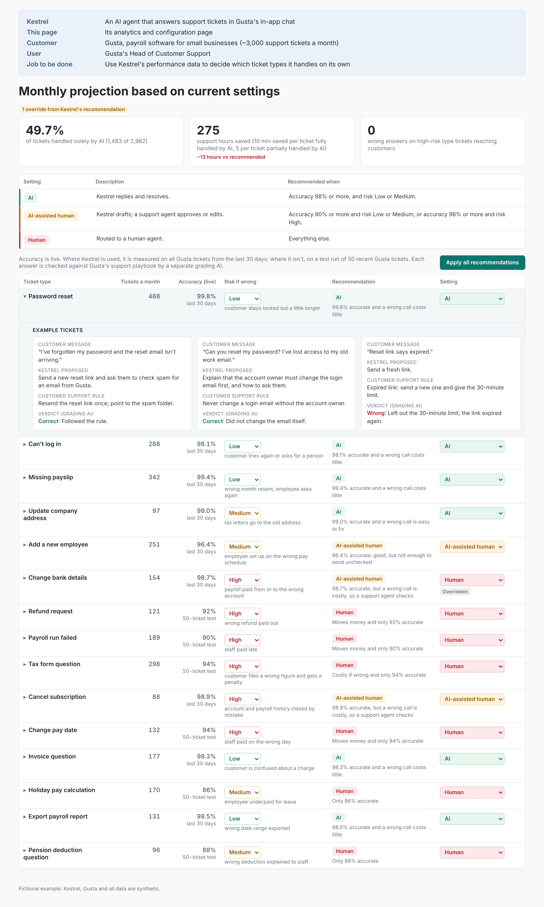
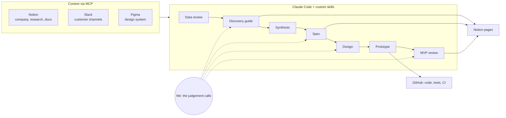

# Product workflow

[](https://github.com/kfauzie/product-workflow/actions/workflows/checks.yml)

How I go from a customer's ask to a tested, working prototype with Claude Code: discovery notes, research synthesis, spec, design, prototype, then hand-off to engineering. Each step is a skill in [`.claude/commands/`](.claude/commands/), grounded in company, customer and design context pulled through MCP.

**[Open the live prototype ›](https://kfauzie.github.io/product-workflow/)**

[Source: context, data and code](examples/kestrel/) · [decisions I made](examples/kestrel/run/RUN.md#decisions-i-made-and-what-i-turned-down)



> **The example in [`examples/kestrel/`](examples/kestrel/) is FICTIONAL.** Kestrel, Gusta and all data are synthetic. It shows the workflow end to end on a realistic B2B SaaS case: deciding which support tickets an AI agent can handle on its own.

## What the demo shows
Kestrel's analytics and configuration page, for Gusta's Head of Customer Support. Kestrel is an AI agent that answers support tickets in Gusta's in-app chat.

| Part | What it shows |
|---|---|
| Monthly projection based on current settings | **49.7%** of tickets handled solely by AI (1,483 of 2,982) · **275** support hours saved (10 minutes per ticket fully handled by AI, 5 per ticket partially handled by AI) · **0** wrong answers on high-risk type tickets reaching customers. Recalculates as settings change; each change flashes green or red and shows the difference from Kestrel's recommendation |
| Settings | **AI**: Kestrel replies and resolves (recommended at 98%+ accuracy and risk Low or Medium) · **AI-assisted human**: Kestrel drafts, a support agent approves or edits (90%+ and risk Low or Medium, or 98%+ and risk High) · **Human**: routed to a human agent (everything else) |
| The table | 15 ticket types: tickets a month, live accuracy, risk if wrong, Kestrel's recommendation with its reason, and the setting Gusta controls |
| Adjustments | Risk and setting are both editable. Changing a risk shows "Adjusted by user" and re-runs the recommendation; changing a setting shows "Overridden" and warns when it gives Kestrel more autonomy than recommended. A confirmation appears after each change. The page opens with one override (Change bank details kept with a human); "Apply all recommendations" resets it |
| Example tickets | 3 under each ticket type: customer message, what Kestrel proposed, the customer support rule, and the grading AI's verdict |

Accuracy is live. Where Kestrel is used, it is measured on all Gusta tickets from the last 30 days; where it isn't, on a test run of 50 recent tickets. Each answer is checked against Gusta's support playbook by a separate grading AI. Every number on the page is calculated from [the data](examples/kestrel/run/data/ticket_types.json) and checked by [tests](examples/kestrel/run/build/test_mvp.js) on every push.

## My AI stack



- **AI** for what needs judgement on messy input: reading notes, drafting, suggesting.
- **Code** for everything fixed: every number on a screen is calculated and tested, never written by the model.
- **Me** for the decisions: what the problem is, what to cut, what ships.

## The workflow, end to end

| Step | Skill | Grounded in | Output | In the example |
|---|---|---|---|---|
| 1. Data review | [`pm-1-data-discovery`](.claude/commands/pm-1-data-discovery.md) (Initial review) | The customer's data; glossary for columns and units | 2–5 findings, each an interview question, every number from code | [01-data-review](examples/kestrel/run/01-data-review.md) |
| 2. Discovery notes | [`pm-2-discovery-interview`](.claude/commands/pm-2-discovery-interview.md) | Findings from step 1; personas as things to listen for | A 10-minute guide in Notion; notes from the call | [02-guide](examples/kestrel/run/02-discovery-guide.md), [03-notes](examples/kestrel/run/03-discovery-notes.md) |
| 3. Research synthesis | `pm-1-data-discovery` (Answer) | The notes; the data | Each claim tested: supported, not supported or unclear | [04-synthesis](examples/kestrel/run/04-synthesis.md) |
| 4. Spec | [`pm-3-problem-to-solution-concept`](.claude/commands/pm-3-problem-to-solution-concept.md) | Notes, tested claims, company context, personas | Problem, 2–3 ideas weighed on user, commercial and effort; the recommendation; workflow; AI / code / people split; success criteria; assumptions | [05-solution-concept](examples/kestrel/run/05-solution-concept.md) |
| 5. Design | [`pm-4-solution-design`](.claude/commands/pm-4-solution-design.md) | The spec; design system from Figma; glossary | Per screen: input, output, happy path, edge cases, acceptance criteria, handoff; then the screens | [06-screen-specs](examples/kestrel/run/06-screen-specs.md), [design/](examples/kestrel/run/design/) |
| 6. Prototype | [`pm-5-mvp-build`](.claude/commands/pm-5-mvp-build.md) | Agreed screens; spec's test cases | One HTML file, numbers by code, tests and a headless check | [build/](examples/kestrel/run/build/) |
| 7. MVP review | [`pm-6-mvp-review`](.claude/commands/pm-6-mvp-review.md) | The spec's assumptions; the prototype | Questions that could change the solution; the sample needed to test the AI parts | [07-mvp-review](examples/kestrel/run/07-mvp-review.md) |
| 8. Hand-off | `pm-5-mvp-build` ("later, if asked") | The prototype and its tests | One PR per screen behind a feature flag, engineer review, staging, release | Not shown in the example |

Every skill also reads [`pm-standard`](.claude/commands/pm-standard.md): what good looks like, the communication guide and the document style.

## How MCPs ground it
Four context skills replace anything company-specific. Each reads the active context folder first, then MCP, then asks me, and never fills a gap from the model's memory:

| Context skill | Pulls from |
|---|---|
| [`company-context`](.claude/commands/company-context.md) | Notion (company, product, pricing pages), Slack (announcements, customer channels) |
| [`product-glossary`](.claude/commands/product-glossary.md) | Notion product docs, labels in Figma |
| [`customer-personas`](.claude/commands/customer-personas.md) | Notion research, Slack customer channels |
| [`design-system`](.claude/commands/design-system.md) | Figma variables, styles and components |

Documents I read or annotate (guide, notes, spec, review) are written to Notion; data, code, screens and the run log stay in the repo.

## How each skill is written
Every skill has the same frame:
- **Header:** Role · Users · Target · Grounding · Tone.
- **Each step:** Input · Output · Happy path · Edge cases · Acceptance criteria · Handoff.

The aim is that the next person, or the next skill, knows exactly what they receive and when it's good enough.

## Principles behind it
- I start with the persona and the job they need to get done, and go simplest first.
- I choose based on user insight, commercial benefit to the company, and implementation effort.
- If it follows fixed logic, it's code. If it needs judgment, it's AI. Every number on a screen is calculated, never written by the model.
- I go after the why behind the why.

## How I use this at work
- **Day to day:** Claude Code with custom skills and MCPs for GitHub, Slack, Notion and Figma, for customer research, data analysis, specs, design, prototyping and PRs.
- **ExaCare AI:** I built an eval agent (SQL, TypeScript, Claude API, Notion and Linear MCPs, GitHub Actions) that diagnosed failures daily and drove five prioritised fixes a week for the squad.
- **Savvy:** I designed an agent development platform that turned each customer's workflow and data into a first-pass agent, cutting time to the first working agent from a month to a week.

## Try the example
The quickest way is the [live prototype](https://kfauzie.github.io/product-workflow/). To run it locally:
```bash
pip install -q -r requirements.txt && npm install && npx playwright install chromium
```
```bash
tools/open_run.sh
```
```bash
npm test
```
`npm test` runs the known-answer tests and a headless click-through; the same checks run on every push. Regenerate the synthetic data with `python3 notebooks/make_data.py` from `examples/kestrel/run`.

## About
Built by Kevin Fauzie, an AI product manager in London: a decade as a PM, a co-founded AI agent startup, a Stanford MBA. [LinkedIn](https://www.linkedin.com/in/kevinardian/)
