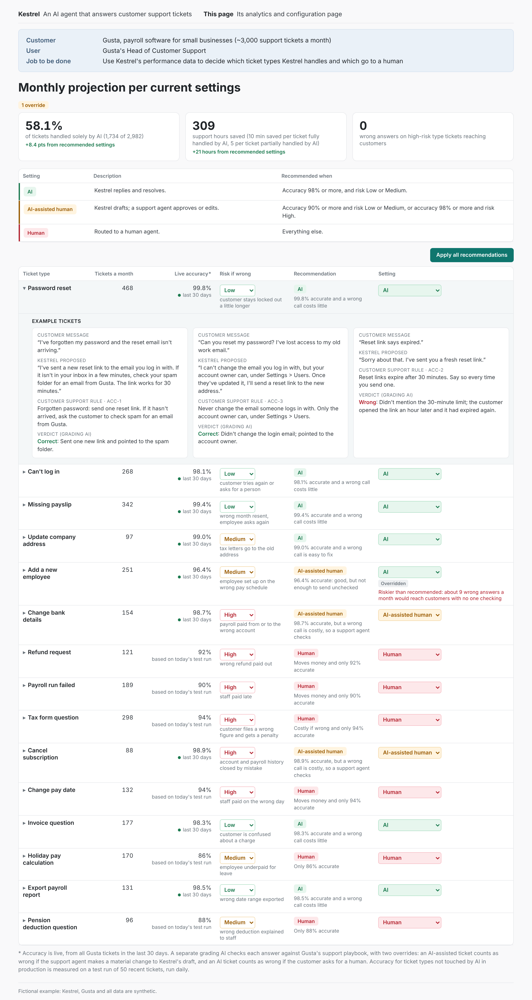
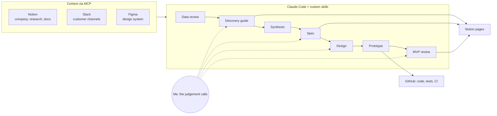

# Product workflow

[](https://github.com/kfauzie/product-workflow/actions/workflows/checks.yml)

How I go from a customer's ask to a tested, working prototype with Claude Code: discovery notes, research synthesis, spec, design, prototype, then hand-off to engineering. Each step is a skill in [`.claude/commands/`](.claude/commands/), numbered in the order they run, grounded in company, customer and design context pulled through MCP.

**[Open the live prototype ›](https://kfauzie.github.io/product-workflow/)**

[Source: context, data and code](examples/kestrel/) · [decisions I made](examples/kestrel/RUN.md#decisions-i-made-and-what-i-turned-down)



> **The example in [`examples/kestrel/`](examples/kestrel/) is FICTIONAL.** Kestrel, Gusta and all data are synthetic. It shows the workflow end to end on a realistic B2B SaaS case: deciding which support tickets an AI agent can handle on its own.

## What the demo shows
Kestrel's analytics and configuration page, for Hannah Okafor, Gusta's Head of Customer Support. Kestrel is an AI agent that answers support tickets in Gusta's in-app chat.

| Part | What it shows |
|---|---|
| Monthly projection per current settings | **44.4%** of tickets handled solely by AI (1,386 of 3,122) · **364** support hours saved (10 minutes per ticket fully handled by AI, 5 per ticket partially handled by AI) · **0** wrong answers reaching customers on ticket types that are Hard to undo. Recalculates as settings change; each change flashes green or red and shows the difference from the recommended settings |
| Settings | **AI**: Kestrel replies and resolves (recommended at 98%+ accuracy when a wrong answer is Easy to fix or Fixable) · **AI-assisted human**: Kestrel drafts, a support agent approves or edits (60%+ whatever the impact, since a support agent checks every draft) · **Human**: routed to a human agent (below 60%, where a draft wouldn't save a support agent time and may confuse them instead; today only Other, the tickets that match no type) |
| The table | 16 ticket types: tickets a month, accuracy (live where Kestrel is in use: a dot blinks every second, and every 5 seconds one ticket type updates, rows higher in the table more often, shown in green or red), impact if wrong (Easy to fix, Fixable or Hard to undo), Kestrel's recommendation with its reason, and the setting Gusta controls |
| Adjustments | Impact and setting are both editable. Changing an impact shows "Adjusted by user" and re-runs the recommendation; changing a setting shows "Setting overridden" and warns when it gives Kestrel more autonomy than recommended. A confirmation appears after each change. The page opens with one setting override (Update company address moved down from AI to AI-assisted human, so the cost of caution shows: 3.1 points less AI share, 8 fewer hours); "Apply all recommendations" resets it |
| Recent tickets | 3 under each ticket type: customer request and Kestrel's reply in a chat window, then an evaluation box with the rule it was graded against (quoted by ID from Gusta's fictional [support playbook](examples/kestrel/data/support_playbook.md)), and the grading AI's verdict (Correct or Wrong) |

Where Kestrel is in use, accuracy is live, from all Gusta tickets in the last 30 days. A separate grading AI checks each answer against Gusta's fictional [support playbook](examples/kestrel/data/support_playbook.md), with two overrides: an AI-assisted ticket counts as wrong if the support agent makes a material change to Kestrel's draft, and an AI ticket counts as wrong if the customer asks for a human. Accuracy for ticket types not touched by AI in production is measured on a test run of 50 recent tickets, run daily. Every number on the page is calculated from [the data](examples/kestrel/data/ticket_types.json) and checked by [tests](examples/kestrel/build/test_mvp.js) on every push.

## My AI stack



- **AI** for what needs judgement on messy input: reading notes, drafting, suggesting.
- **Code** for everything fixed: every number on a screen is calculated and tested, never written by the model.
- **Me** for the decisions: what the problem is, what to cut, what ships.

## The workflow, end to end

Skills run in number order. [`0-pm-standard`](.claude/commands/0-pm-standard.md) comes first because every other skill reads it: what good looks like, the communication guide and the document style. `1-pm-data-discovery` runs twice: before the interview, and again to test what the customer said.

| Step | Skill | Grounded in | Output | In the example |
|---|---|---|---|---|
| Data review | [`1-pm-data-discovery`](.claude/commands/1-pm-data-discovery.md) (Initial review) | The customer's data; glossary for columns and units | 2–5 findings, each an interview question, every number from code | [01-data-review](examples/kestrel/01-data-review.md) |
| Discovery notes | [`2-pm-discovery-interview`](.claude/commands/2-pm-discovery-interview.md) | Findings from the data review; personas as things to listen for | A 10-minute guide in Notion; notes from the call | [02-guide](examples/kestrel/02-discovery-guide.md), [03-notes](examples/kestrel/03-discovery-notes.md) |
| Research synthesis | `1-pm-data-discovery` (Answer) | The notes; the data | Each claim tested: supported, not supported or unclear | [04-synthesis](examples/kestrel/04-synthesis.md) |
| Spec | [`3-pm-problem-to-solution-concept`](.claude/commands/3-pm-problem-to-solution-concept.md) | Notes, tested claims, company context, personas | Problem, 2–3 ideas weighed on user, commercial and effort; the recommendation; workflow; AI / code / people split; success criteria; assumptions | [05-solution-concept](examples/kestrel/05-solution-concept.md) |
| Design | [`4-pm-solution-design`](.claude/commands/4-pm-solution-design.md) | The spec; design system from Figma; glossary | Per screen: input, output, happy path, edge cases, acceptance criteria, handoff; then the screens | [06-screen-specs](examples/kestrel/06-screen-specs.md), [design/](examples/kestrel/design/) |
| Prototype | [`5-pm-mvp-build`](.claude/commands/5-pm-mvp-build.md) | Agreed screens; spec's test cases | One HTML file, numbers by code, tests and a headless check | [build/](examples/kestrel/build/) |
| MVP review | [`6-pm-mvp-review`](.claude/commands/6-pm-mvp-review.md) | The spec's assumptions; the prototype | Questions that could change the solution; the sample needed to test the AI parts | [07-mvp-review](examples/kestrel/07-mvp-review.md) |
| Hand-off | `5-pm-mvp-build` ("later, if asked") | The prototype and its tests | One PR per screen behind a feature flag, engineer review, staging, release | Not shown in the example |

## How MCPs ground it
Four context skills replace anything company-specific. Each reads the active context folder first, then MCP, then asks me, and never fills a gap from the model's memory:

| Context skill | Pulls from |
|---|---|
| [`company-context`](.claude/commands/company-context.md) | Notion (company, product, pricing pages), Slack (announcements, customer channels) |
| [`product-glossary`](.claude/commands/product-glossary.md) | Notion product docs, labels in Figma |
| [`customer-personas`](.claude/commands/customer-personas.md) | Notion research, Slack customer channels |
| [`design-system`](.claude/commands/design-system.md) | Figma variables, styles and components |

Documents I read or annotate (guide, notes, spec, review) are written to Notion; data, code, screens and the run log stay in the repo.

## How each skill is written
Every skill has the same frame:
- **Header:** Role · Users · Target · Grounding · Tone.
- **Each step:** Input · Output · Happy path · Edge cases · Acceptance criteria · Handoff.

The aim is that the next person, or the next skill, knows exactly what they receive and when it's good enough.

## Principles behind it
The full set is in [`0-pm-standard`](.claude/commands/0-pm-standard.md); every skill applies them.
1. **Own the problem end to end:** investigate, then build, hands-on up to a working prototype.
2. **Find the real problem:** the why behind the why, from real, recent examples and representative users.
3. **Decide on user insight, commercial benefit and effort,** starting from the metric that matters.
4. **Start simple, ship early:** one persona first; more complex only when simple isn't enough.
5. **Let the best evidence win:** every number from code, every claim backed by data or the customer's words.
6. **Set the bar by what a mistake costs:** code for fixed logic, AI for judgement, more checks where a mistake is harder to undo.
7. **Earn trust by showing the work:** how each answer was produced, and where it came from.
8. **Match the response to the size of the change:** small changes, small notes; when something breaks, fix the pattern, not the case.

## How I use this at work
- **Day to day:** Claude Code with custom skills and MCPs for GitHub, Slack, Notion and Figma, for customer research, data analysis, specs, design, prototyping and PRs.
- **ExaCare AI:** I built an eval agent (SQL, TypeScript, Claude API, Notion and Linear MCPs, GitHub Actions) that diagnosed failures daily and drove five prioritised fixes a week for the squad.
- **Savvy:** I designed an agent development platform that turned each customer's workflow and data into a first-pass agent, cutting time to the first working agent from a month to a week.

## Try the example
The quickest way is the [live prototype](https://kfauzie.github.io/product-workflow/). To run it locally:
```bash
pip install -q -r requirements.txt && npm install && npx playwright install chromium
```
```bash
tools/open_run.sh
```
```bash
npm test
```
`npm test` runs the known-answer tests and a headless click-through; the same checks run on every push. Regenerate the synthetic data with `python3 notebooks/make_data.py` from `examples/kestrel/`.

## About
Built by Kevin Fauzie, an AI product manager in London: a decade as a PM, a co-founded AI agent startup, a Stanford MBA. [LinkedIn](https://www.linkedin.com/in/kevinardian/)
